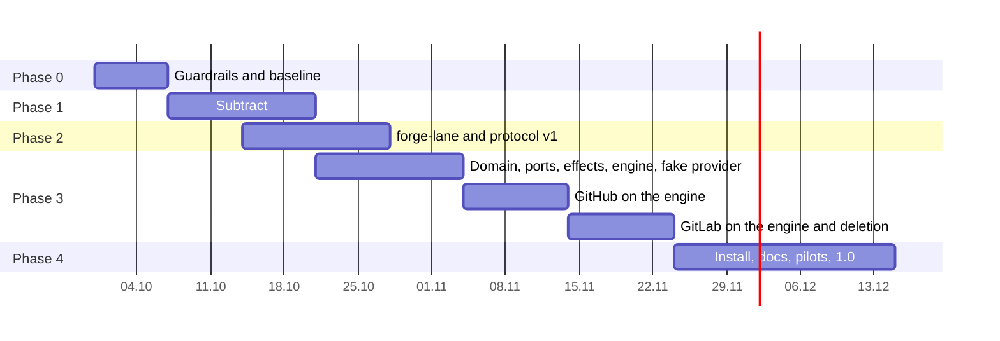

# forge simplification program — roadmap

The task breakdown for [DESIGN.md](DESIGN.md) and
[ADR-0035](../../adr/0035-simplification-program.md). Each task maps to one
issue and one PR of about 500 net lines or fewer; pure deletions are
exempt.

Each task lists **Goal**, **Work**, **Done when**, **Depends** and
**Size** (S ≤ ½ day, M ≤ 2 days, L ≤ 4 days of agent work plus owner
review).

**Definition of Done for every task:**

- The default suite and the Invariant Suite are green.
- The ratchets, import contracts and prose lint pass (once they exist).
- Docs touched by the change are updated.
- The PR template is filled: invariants, metrics delta, ADR impact and
  ledger rows.
- No review or issue IDs are added to code.

---

## Phase 0 — Guardrails and baseline (week 1)

The step-by-step implementation plan is [PLAN-phase-0.md](PLAN-phase-0.md).

**Exit criteria:**

- ADR-0035 is accepted.
- `release/0.42.x` and the tag `pre-simplification` exist.
- The default suite is hermetic on macOS and Linux.
- The Invariant Suite, import contracts, ratchets and prose lint are
  required CI jobs.
- `metrics.md` is generated by a script.
- `forge doctor` never raises.

### P0-01 Accept ADR-0035 and mark the affected ADRs
- **Goal:** make the program binding under AGENTS.md rule 4.
- **Work:**
  - ADR-0035 is already Accepted (2026-09-29).
  - Add a status line to each affected ADR:
    - "Superseded by ADR-0035": 0019, 0021, 0027, 0029, 0030, 0031, 0033, 0034;
    - "Amended by ADR-0035": 0002, 0013, 0015, 0020, 0022, 0023, 0025, 0028, 0032;
    - "Superseded on main by ADR-0035 (valid on release/0.42.x)": 0024.
  - Update any ADR ranges left in the docs.
- **Done when:** every ADR in the ADR-impact table of ADR-0035 carries the
  status line.
- **Depends:** —
- **Size:** S

### P0-02 Create the maintenance branch and recovery tag
- **Goal:** Azure users and rollbacks have a home before anything is
  deleted.
- **Work:**
  - Create `release/0.42.x` from `7ed64ba` (the `v0.42.0` tag plus its release evidence and pins), cherry-pick the `release/**` CI trigger onto it, and create the tag
    `pre-simplification` on the last pre-deletion commit.
  - Write `docs/operations/maintenance-0.42.md`: security fixes only, Azure
    is supported there, and backports follow the normal CI.
  - Make sure CI runs on `release/**`.
- **Done when:** the branch builds green, and the policy doc and tag exist.
- **Depends:** —
- **Size:** S

### P0-03 Make the lane-install tests hermetic
- **Goal:** fix the 8 macOS failures that assume `python` is on `PATH`.
- **Work:** in `tests/test_lane_install_contract.py`, prepend to `PATH` a
  temporary directory with a `python` shim that execs `sys.executable`.
  Apply the same shim wherever real `bash -c` runs install fragments.
- **Done when:** the file passes on macOS (only `python3` available) and on
  Linux CI.
- **Depends:** —
- **Size:** S

### P0-04 Subprocess hygiene in tests
- **Goal:** no orphaned `fake_native_server.py`, `durable_ingress_server.py`,
  worker or `redis-server` processes.
- **Work:**
  - A shared fixture helper in `tests/production_entry/conftest.py` and
    `tests/fi_os/` starts every child with `start_new_session=True`,
    records its pgid, and kills the group (SIGTERM, then SIGKILL after 5s)
    in teardown and `atexit`.
  - A session-finish hook fails the run if any recorded pgid is still
    alive.
  - Document how to find and kill leftovers from older runs in
    `docs/reference/testing.md`.
  - Known gap, follow-up: `redis-server` (started by `tests/production_entry/test_durable_ingress.py`) and the `python -m forge.worker` processes of `tests/fi_os/worker.py` are not guarded yet. Wrap them in a guarded launcher (or pass a lifeline pipe) before relying on local runs of those suites.
  - Known gap, follow-up: `scripts/pg_gate.py` records pytest's return code but decides from JUnit outcomes only, so it does not fail on the leaked-process check; enforce it there.
- **Done when:** a full run leaves zero forge test processes, verified by
  `ps` in a CI step.
- **Depends:** —
- **Size:** M

### P0-05 Split the default and slow test tiers
- **Goal:** the default suite finishes in ≤ 8 minutes, and slow suites
  still run.
- **Work:**
  - Register the markers `slow` and `invariant`.
  - Mark `tests/production_entry/`, `tests/fi_os/` and every test that
    spawns `redis-server` or a real worker process as `slow` (by path, in
    a collection hook).
  - There is no `addopts` filter, because it would deselect the explicit
    selections of `scripts/pg_gate.py`. CI passes `-m "not slow"` to the
    default job instead.
  - In `ci.yml`, add a job `tests-slow` on `main`, nightly and on
    `workflow_dispatch`.
  - Record timings with `--durations=30` in CI output.
- **Done when:** the default suite takes ≤ 8 minutes on CI, and
  `tests-slow` is green on `main`.
- **Depends:** P0-04
- **Size:** S

### P0-06 Build the Invariant Suite
- **Goal:** I1–I8 and the self-trigger rule are named and required.
- **Work:**
  - Create `tests/invariants/` with one module per invariant (listed
    below). Each module holds new focused tests or thin wrappers that run
    the strongest existing tests; see DESIGN §4.
  - Add a required CI job `invariants` with a Postgres service. It selects
    the registered files, `pytest $(python -m tests.invariants.registry)`,
    and fails on any skip (`scripts/assert_no_skips.py`).

  | Module | Content |
  | --- | --- |
  | `test_i1_no_merge.py` | New static scan: provider clients and lane templates contain no merge endpoints or mutations; templates disable push |
  | `test_i2_single_write_path.py` | `test_publication_boundary.py` cases |
  | `test_i3_intent_before_effect.py` | Publication-intent recovery cases |
  | `test_i4_consume_once_approval.py` | Gate consumption, spec digests, approved-input proof |
  | `test_i5_budget.py` | Reserve before spend, idempotent receipts, unknown ≠ 0, closing partition |
  | `test_i6_one_draft.py` | A fast in-process variant of the concurrent publication race |
  | `test_i7_crash_safety.py` | Coroutine failure injection on the publication and dispatch steps |
  | `test_i8_candidate_bound_verification.py` | Staleness when the head moves |
  | `test_self_trigger_guard.py` | Bot-authored notes are never commands |

- **Done when:** the job is required on `main`, and each module fails when
  its invariant is broken. Show this with a local mutation, noted in the
  PR description.
- **Depends:** P0-05
- **Size:** L

### P0-07 Add import contracts (ratchet mode)
- **Goal:** mechanical boundaries that later phases tighten.
- **Work:**
  - Add `import-linter` to the dev group and a `.importlinter`. Initial
    contracts:
    - `forge.durable` must not import `forge.runs`, `forge.adaptive`,
      `forge.gateway` or `forge.integrations`;
    - `forge.harnesses` must not import `forge.runs.service*`.

    P2-01 adds the contracts for the new packages.
  - Existing violations go into `ignore_imports` with a counter that may
    only shrink.
  - Add a CI job `imports`.
- **Done when:** CI enforces the contracts, and the ignore list is
  committed.
- **Depends:** —
- **Size:** M

### P0-08 Size ratchet
- **Goal:** no file or function grows, and new code is small.
- **Work:**
  - `scripts/ratchet.py` computes per-file and per-function line counts
    (AST) for `src/` and `packages/*/src/`.
  - A baseline JSON is committed. CI fails if any existing entry grows, or
    if a new file exceeds 600 lines or a new function exceeds 80 lines.
  - `--update` may only lower numbers.
  - The same script fails if any module other than `engine/effects.py`
    and `api/app.py` names `WritePort` (DESIGN §6.1). This check is active
    once `ports.py` exists.
  - Add a diff-coverage gate: `coverage` plus `diff-cover`, at least 85%
    on new and changed lines of new modules.
- **Done when:** CI enforces it, and a synthetic growth PR fails.
- **Depends:** —
- **Size:** M

### P0-09 Prose lint
- **Goal:** stop adding review archaeology to code.
- **Work:** `scripts/prose_lint.py` checks the added lines of
  `git diff origin/main...HEAD -- src/`. It rejects the patterns
  `\b[RQ]\d{2}-\d{2}\b`, `#\d{3,}\b` (issue refs) and
  "review `<sha>`". It allows `ADR-\d{4}`.
- **Done when:** a CI job runs it, and a synthetic PR with an `R42-16`
  comment fails.
- **Depends:** —
- **Size:** S

### P0-10 Metrics script and baseline
- **Goal:** progress is measured, not asserted.
- **Work:**
  - `scripts/metrics.py` (see the static import analysis method in
    DESIGN §2) reports:
    - runtime, tooling-only and tests-only lines;
    - lane-reachable lines;
    - the largest files and functions, and counts of functions over 80,
      100 and 200 lines;
    - prose share;
    - direct dependencies;
    - Markdown words;
    - default-suite duration from JUnit XML.
  - It writes `docs/roadmap/2026-09-29-simplification/metrics.md` (table
    with a date column appended).
- **Done when:** running it reproduces the §2 baseline within ±1%, and a
  snapshot is recorded with `--write` at every phase gate.
- **Depends:** —
- **Size:** M

### P0-11 Optional provider settings and a doctor that never raises
- **Goal:** a fresh clone gets a report, not a traceback.
- **Work:**
  - Add `FORGE_GITLAB_ENABLED` (default `true`), consistent with the
    existing `FORGE_GITHUB_ENABLED` and `FORGE_AZDO_ENABLED` flags.
  - `GITLAB_URL`, `GITLAB_TOKEN` and `GITLAB_WEBHOOK_SECRET` become
    optional and are validated only when GitLab is enabled. GitLab ingress
    fails closed (503) when its secret is empty.
  - `doctor.main` catches `ValidationError` and prints FAIL lines that
    name the missing variables. It exits 1 and never prints a traceback.
- **Done when:** in an empty environment, `python -m forge.doctor` prints
  FAIL lines and exits 1; `--json` works; tests cover it.
- **Depends:** —
- **Size:** S

### P0-12 Seed the edge-case register
- **Goal:** hard-won knowledge survives deletions.
- **Work:**
  - Create `docs/reference/edge-cases.md` from DESIGN §13, the
    "Known gotchas" section of AGENTS.md and ADR-0028. Each entry has a
    symptom, a cause and the pinning test (file::test).
  - Write missing tests for entries without one.
- **Done when:** every entry names an existing test.
- **Depends:** —
- **Size:** M

### P0-13 Test disposition ledger
- **Goal:** every test file has a fate before code is deleted.
- **Work:**
  - `scripts/build_test_ledger.py` generates `test-ledger.csv` with columns
    `file, tests, loc, imports_runtime, imports_tests_only, area,
    disposition, phase, note`.
  - `disposition` ∈ {keep, port-engine, port-adapter, drop-with-code,
    drop-obsolete} is pre-filled by rule and then curated.
- **Done when:** all 288 test files (`tests/**/test*.py`, nested suites
  included) have a disposition, and the owner has reviewed the `drop-*`
  rows.
- **Depends:** P0-10
- **Size:** M

### P0-14 PR template and agent working agreement
- **Goal:** every PR carries the same checklist.
- **Work:**
  - Add `.github/pull_request_template.md` with sections for invariants,
    metrics delta, ADR impact, ledger rows and out-of-scope changes.
  - Rewrite AGENTS.md: accurate repo map, commands, the new rules (the
    ratchets, no review IDs, PR size) and pointers to DESIGN and ROADMAP.
    Remove the stale counts ("2600+ tests", "read ADR 0001-0027").
- **Done when:** the template is merged, and AGENTS.md has no stale
  numbers.
- **Depends:** —
- **Size:** S

---

## Phase 1 — Subtract (weeks 2–3)

**Exit criteria:**

- `src/forge` ≤ 110K lines.
- No module is reached only by tests.
- The wheel contains no qualification tooling.
- Azure, builtin, Codeward legacy and the deferred features are gone.
- Direct runtime dependencies ≤ 10.
- The default suite takes ≤ 8 minutes.
- Release `0.43.0` is dogfooded on GitHub and in the GitLab lab for one
  week without new `harness_*` or `effect_unknown` classes.

Order: P1-01 first, then the deletion clusters. The prose and docs diets
run last so that they do not churn code about to be deleted.

### P1-01 Extract project config from `orchestrator/`
- **Goal:** unblock the legacy deletion.
- **Work:** move `orchestrator/project_config.py` (`ProjectConfig`,
  `ConfigReadResult`, `read_project_config`) to `forge/project_config.py`.
  Update **every** importer found by grep: the runs services
  (`service.py:214`, `github_service.py:209`, `azure_service.py:143`),
  `runs/revival.py`, `adaptive/system_context.py`, `doctor.py`,
  `mcp_client/manager.py`, `orchestrator/orchestrator.py`,
  `flows/runner.py` and `findings/triage.py`. No behavior change.
- **Done when:** nothing imports `forge.orchestrator.project_config`, and
  the tests are green.
- **Depends:** P0
- **Size:** S

### P1-02 Remove the publication-saga cluster
- **Goal:** delete test-only authority code.
- **Work:**
  - Delete `adaptive/publication_saga.py`, `saga_durable.py`,
    `saga_native.py` and `two_writer_qualification.py`, together with
    their tests per the ledger.
  - Register their edge cases first ("adopt, never re-publish" is already
    covered by I3).
- **Done when:** grep finds no importers, the ledger rows are closed, and
  the metrics move.
- **Depends:** P0-12, P0-13
- **Size:** S

### P1-03 Remove the test-only adaptive modules
- **Goal:** delete the rest of the 19.5K test-only lines.
- **Work:**
  - Delete `workpackage_service`, `runtime`, `compat`, `compat_fixtures`,
    `dedup`, `snapshots`, `impact`, `project_map`, `read_guards`,
    `benchmark`, `system_manifest`, `system_verification`,
    `executed_evidence`, `independent_checks`, `verification_executor`,
    `dotnet_recipe`, `forge.runs.conformance` and
    `forge.agents.classifier`, with their tests.
  - Before each deletion, grep for string imports (`import_module`,
    entry points, templates) and for the module name in `ci/`,
    `.github/` and `scripts/`.
  - One PR per 3–4 modules.
- **Done when:** `scripts/metrics.py` reports 0 test-only modules (except
  explicit test helpers).
- **Depends:** P1-02
- **Size:** M

### P1-04 Remove the reference twins
- **Goal:** keep reference doubles out of production code.
- **Work:** delete `adaptive/reference/` and its tests
  (`test_reference_separation.py` and the related ones). Tests that still
  need a provider-shaped double use `tests/fixtures/` fakes.
- **Done when:** `forge.adaptive.reference` does not exist.
- **Depends:** P1-03
- **Size:** S

### P1-05 Replace the boundary registry with import contracts
- **Goal:** one boundary mechanism.
- **Work:**
  - Translate the enforceable rules of `adaptive/boundary_registry.py`
    and `tests/test_architecture_boundaries.py` into `.importlinter`
    contracts. Examples: only the publisher module imports provider write
    paths; only the admission module acquires leases.
  - Delete the registry and its test.
  - Rules that cannot be expressed as imports are listed in the PR for
    the owner to drop or keep as focused tests.
- **Done when:** the registry is deleted, and the contracts are green.
- **Depends:** P0-07
- **Size:** M

### P1-06 Remove the closure matrix
- **Goal:** evidence grading is no longer a runtime concern.
- **Work:** delete `adaptive/closure_matrix.py`,
  `docs/operations/closure-matrix.md` and its tests.
- **Done when:** nothing references it.
- **Depends:** P1-03
- **Size:** S

### P1-07 Retire the qualification machinery from the package
- **Goal:** the wheel is the product only.
- **Work:**
  - Delete `release_manifest.py`, `release_promotion.py`,
    `profile_qualification.py` and `capability_manifest.py`.
  - Delete the tooling-only adaptive modules: `ops_drills`,
    `delivery_economics`, `research_cohort`, `research_cohort_live`,
    `pilot`, `pilot_ladder`, `checkpoint_migration`,
    `steering_causality`, `discovery_profile`, `discovery_authority` and
    `support_matrix`. Delete their scripts: `run_*`, `build_*`,
    `freeze_supported_profile.py`, `generate_template_pins.py`,
    `gate_conformance.py`, `pg_gate.py` (only if superseded by P1-08),
    `qualify_gitlab_ce.py` and `cold_install_*`.
  - Move the surviving dev and lab scripts (`align_lab.py`,
    `inventory_lab.py`, `setup_gitlab.py`, `driver_live_smoke.py`,
    `gh_live_smoke.py`, `canary_smoke.py`) to `tools/`, which is outside
    the wheel.
  - Remove the `forge gate` CLI subcommand and the `--capabilities` and
    `--support-matrix` doctor modes.
  - The README blocks generated by `generate_template_pins.py` become
    static text until P1-17 rewrites the README.
- **Done when:** `unzip -l` on the built wheel lists no qualification
  modules; `tools/` scripts run with `uv run --project tools`.
- **Depends:** P1-08 (the new release flow must land first), P1-06
- **Size:** L (mostly deletions)

### P1-08 Simplify the release and CI workflows
- **Goal:** tested bytes are shipped bytes by construction.
- **Work:**
  - Rewrite `release.yml` per DESIGN §9:
    1. build the wheel, sdist and image once and record their digests;
    2. install the built wheel in a fresh venv and run the default suite
       and the Invariant Suite;
    3. boot the built image on a fresh Postgres, migrate and check
       health;
    4. stage the RC as a GitHub pre-release with the exact wheels, and
       push the image by digest;
    5. run the **mandatory, automated** live smokes on the RC:
       - GitHub: sandbox repository;
       - GitLab: a gitlab.com sandbox project, or a self-hosted runner
         attached to the lab.

       Until lane v1 exists (Phase 2), the smokes drive the current lanes
       with the RC wheel pinned by sha256.
    6. write a signed `release-report.json`, an SBOM
       (`anchore/sbom-action`), provenance
       (`actions/attest-build-provenance`) and the cosign signature;
    7. promote the same digests to the final release without
       rebuilding.
  - Simplify `ci.yml` to: lint, typecheck, default tests on 3.13 and
    3.14, invariants, imports, ratchet, prose lint, diff coverage,
    integration (real Postgres migrations plus failure injection on
    Postgres), and nightly `tests-slow`.
  - Remove the exact-composition, conformance-mutation and promotion
    steps.
- **Done when:** a dry-run tag on a fork produces an RC, both smoke
  results, the signed report, attestations and a promoted final release
  with identical digests; `ci.yml` is green.
- **Depends:** P0-05, P0-06
- **Size:** L

### P1-09 Archive historical evidence
- **Goal:** `main` carries the product, not its history.
- **Work:**
  - Push the branch `archive/evidence-0.42` with the current
    `qualification/`, `evaluation/`, `docs/evaluation/`,
    `docs/releases/evidence/`, `docs/reviews/` and the older
    `docs/roadmap/*`.
  - Delete them from `main`.
  - Add `docs/archive.md` with pointers (branch, tag and what lives
    there).
  - Delete `demo/` (15 MB) from `main`, or move it to the archive branch.
  - Keep `scripts/gate_public_artifacts.py`, which refuses database
    archives in the tracked tree. Drop its evaluation-receipts validation
    and its dependency on `qualification/fixtures-allowlist.json`, and
    move the allowlist into the script's own directory.
- **Done when:** the repository checkout is much smaller (report the
  numbers in the PR); no doc links break (link checker).
- **Depends:** P1-07
- **Size:** S

### P1-10 Remove the builtin implementer
- **Goal:** one implementer backend, the lane.
- **Work:**
  - Delete `factory/implementer.py` and the builtin path in
    `runs/backends.py`, plus its config knobs
    (`FORGE_IMPLEMENTER_BACKEND=builtin`), docs and tests.
  - Keep `factory/planner.py`, `factory/reviewer.py` and
    `factory/llm.py`.
  - A run on a project without a lane is refused at admission with a
    typed reason that links the onboarding doc.
- **Done when:** a grep for `builtin` finds no implementer path; the
  admission refusal is tested.
- **Depends:** P0
- **Size:** M

### P1-11 Remove Azure DevOps from `main`
- **Goal:** Azure lives on `release/0.42.x`.
- **Work:**
  - Delete `runs/azure_service.py`, `integrations/azure.py`,
    `gateway/azure_webhook.py`, `reactive/azure_*`,
    `forge-lane.azure-pipelines.yml`, the Azure config, the Azure docs
    and the Azure tests.
  - Remove the Azure branches in shared modules (revival tables, harness
    selection, doctor).
  - README: "Azure DevOps is supported on 0.42.x; see
    maintenance-0.42.md".
- **Done when:** a grep for `azure` in `src/` finds nothing; metrics drop
  by about 9K lines.
- **Depends:** P0-02
- **Size:** M

### P1-12 Remove the Codeward legacy
- **Goal:** one path for reactive work.
- **Work:**
  - Delete `orchestrator/`, `flows/`, `src/forge/agents/`, the top-level
    `agents/`, `llm/`, `mcp_client/`, the chat paths, the legacy
    mention-event lane in `gateway/router.py` and the legacy task types
    in `worker/`.
  - Keep one redaction module: move `context/redactor.py` next to
    `policy/evidence.py` if the planner or reviewer need it, and delete
    the rest of `context/`.
  - GitLab mention-based `/review`, `/debug` and chat are dropped;
    reactive review returns for GitLab in P3-19.
- **Done when:** no importers remain, `main.py` and `worker/app.py` no
  longer construct `AgentRegistry`, `FlowLoader`, `FlowRunner` or
  `Orchestrator`, and the tests are green.
- **Depends:** P1-01
- **Size:** L

### P1-13 Remove the deferred features
- **Goal:** the scope matches 1.0.
- **Work:**
  - Delete `reactive/ci_debug.py` (the CI-debug lane), `findings/`
    (`/security`), `mcp_server/` and the MCP token settings
    (`FORGE_MCP_*`).
  - The command parser answers `/security` with a typed "not available in
    this version" reply.
  - Update `docs/operations/operator-commands.md`.
- **Done when:** the features are gone, the refusal is tested and the docs
  are updated.
- **Depends:** P1-12
- **Size:** M

### P1-14 Dependency diet
- **Goal:** a smaller and safer supply chain.
- **Work:**
  - Drop `agno[litellm]`, `litellm`, `mcp`, `tiktoken` (if `deptry` shows
    it is unused), the `mysql` extra and `aiomysql`.
  - Add `deptry` to CI.
  - Re-lock with `uv lock`.
- **Done when:** `deptry` is clean and there are ≤ 10 direct runtime
  dependencies.
- **Depends:** P1-12, P1-13
- **Size:** S

### P1-15 Trim the optional operator surfaces
- **Goal:** keep only what `/status`, `/why-blocked` and the operator API
  need.
- **Work:**
  - For `adaptive/support_bundle`, `audit_export`,
    `delivery_measurement`, `delivery_metrics`, `qualification`
    (runtime use), `ops_limits` and `composition_adoption`, confirm the
    callers with `scripts/metrics.py --who-imports`.
  - Delete them or inline the minimum. `composition_adoption` stays until
    P3-16 because GitHub dispatch uses it.
  - Remove the support-bundle endpoints from `api_operator.py`.
- **Done when:** the operator API serves the runs list and detail only;
  the metrics move.
- **Depends:** P1-07
- **Size:** M

### P1-16 Prose diet (surviving modules only)
- **Goal:** code comments explain why, not history.
- **Work:**
  - For each package that survives into the target architecture
    (`durable/`, `gateway/`, `worker/`, `runs/{spec,publisher,candidate,verification,ci_contract,revival,round_admission}.py`,
    `adaptive/{revisions,closing_budget,checkpointing,admission}.py`,
    `factory/`, `repository/`, `config.py`), remove review, issue and
    history narration from comments and docstrings. Keep one-line "why"
    comments. Move missing rationale into ADRs.
  - Use the label `prose-diet`, verified by `scripts/ast_equivalence.py`:
    the AST with docstrings stripped must be identical.
  - Skip `runs/service.py`, `runs/github_service.py`, the lane modules and
    other code scheduled for deletion.
- **Done when:** the prose share is ≤ 18%, and every PR passes the AST
  check.
- **Depends:** P1-02 through P1-15
- **Size:** L (split into about 6 PRs)

### P1-17 Documentation diet
- **Goal:** documentation a newcomer can read.
- **Work:**
  - Rewrite `README.md` (≤ 2 pages: what forge is, the safety model, a
    quickstart link, status).
  - Rewrite `docs/README.md` as an index.
  - Move `docs/research/`, `docs/specs/` and the obsolete
    `docs/operations/*` runbooks (qualification, drills, profiles) to the
    archive branch.
  - Keep: getting-started (GitHub, GitLab), operator commands,
    backup/restore, upgrade, token rotation, the threat model, the FAQ and
    the ADRs.
  - Move the old `CHANGELOG.md` to `docs/archive/CHANGELOG-0.x.md`, and
    start a concise CHANGELOG (Keep a Changelog, one line per change).
- **Done when:** active docs are ≤ 60K words, and the link checker is
  green.
- **Depends:** P1-09
- **Size:** M

### P1-18 Release 0.43.0 and dogfood
- **Goal:** prove that subtraction broke nothing.
- **Work:**
  - Tag `v0.43.0` through the new release workflow.
  - Deploy it to the lab and run at least 5 real `/implement` → `/go`
    tasks on `forcewake/forge` (GitHub) and 3 in the GitLab lab.
  - Record the outcomes in `metrics.md`.
- **Done when:** every run reaches `ready_for_human` or parks with a
  correct typed reason, with no new failure classes.
- **Depends:** P1-01 through P1-17
- **Size:** M

---

## Phase 2 — Separate the lane (weeks 3–5; overlaps the end of Phase 1)

**Exit criteria:**

- `forge-lane` ≤ 8K lines and imports nothing from `forge`.
- Protocol v1 is frozen, with golden fixtures.
- The nightly live smoke on the GitHub sandbox passes: brief → Claude Code
  session → checkpoint round-trip → candidate upload → report.
- The old lane still serves the old services.

### P2-01 Set up the uv workspace
- **Goal:** three distributions in one repository.
- **Work:**
  - Create `packages/forge-protocol/` and `packages/forge-lane/`, each
    with its own `pyproject.toml` and `src/`.
  - Add a root `[tool.uv.workspace]`; the server depends on
    `forge-protocol`.
  - CI builds and tests all three.
  - Versioning: protocol semver; lane and server declare supported
    protocol ranges.
- **Done when:** `uv build --all` produces three wheels, and the import
  contracts cover the new packages.
- **Depends:** P0-07
- **Size:** M

### P2-02 Protocol v1 models
- **Goal:** one versioned wire contract.
- **Work:**
  - Frozen pydantic models (`extra=forbid`): `LaneDispatch`,
    `SessionRequest`/`SessionToken`, `Brief` (`ApprovedInput` view),
    `ControlCommand`/`ControlAck`, `CheckpointManifest`/`Entry`,
    `CandidateBundle`, `LaneReport`, `ModelKeyGrant` and `Heartbeat`.
  - Canonical JSON and digests.
  - Export JSON Schema to `packages/forge-protocol/schemas/` and add
    golden fixtures with round-trip tests.
- **Done when:** schemas are generated in CI, the fixtures pass, and the
  package stays ≤ 1.5K lines.
- **Depends:** P2-01
- **Size:** M

### P2-03 OIDC verification on the server
- **Goal:** lanes authenticate without shared secrets.
- **Work:**
  - `forge/api/lane_auth.py` verifies GitHub
    (`https://token.actions.githubusercontent.com`) and GitLab
    (`<GITLAB_URL>`) JWTs: JWKS cache, issuer, expiry and clock skew.
  - Binding per DESIGN §6.7:
    - **GitHub:** the audience must equal
      `{FORGE_PUBLIC_URL}/lane/{nonce}` for a pending, unexpired dispatch
      nonce, and `repository` and `job_workflow_ref` (path plus allowed
      ref) must match the dispatch record.
    - **GitLab:** the audience must equal `FORGE_PUBLIC_URL`, and
      `pipeline_id` must equal the recorded `gl_pipeline_id`, with
      `project_path` and `ref` matching.
    - On the first session, record `gh_run_id`/`gh_run_attempt` or
      `gl_job_id` and consume the nonce. Reconnects must present the same
      provider run identity.
    - A `jti` replay cache holds entries until expiry.
  - Session tokens are short-lived HS256 JWTs signed with
    `FORGE_SECRET_KEY` and bound to
    `(forge_run_id, attempt, generation)`.
  - There is no shared-secret fallback (post-1.0 backlog, P4-09).
- **Done when:** unit tests with locally signed test JWKS cover:
  - a valid token;
  - wrong audience or nonce;
  - a reused nonce;
  - wrong repository, wrong workflow path or ref;
  - GitLab pipeline mismatch;
  - a different `gh_run_id` on reconnect;
  - an expired token;
  - a replayed `jti`.
- **Depends:** P2-02
- **Size:** M

### P2-04 Server lane API v1
- **Goal:** one HTTP surface for lanes.
- **Work:**
  - Implement the `/lane/v1/*` endpoints of DESIGN §6.7 over the current
    stores, as an adapter layer.
  - Blob storage is filesystem by default (`FORGE_BLOB_DIR`), with
    content-addressed writes via temp file plus atomic rename.
  - Size limits.
  - Candidate upload is idempotent by the candidate identity
    `(forge_run_id, attempt, generation, base_sha, approved_digest,
    diff_sha256)`. The same identity returns the recorded result; a
    different diff for the same `(attempt, generation)` is refused.
  - `POST /model-key` returns the same key to the same session (DESIGN
    §6.9). It is stubbed against a fake gateway until P3-12.
  - The old `/lane/*` endpoints stay untouched.
- **Done when:** API tests cover the whole happy path and every refusal,
  and the handlers are ≤ 80 lines each.
- **Depends:** P2-03
- **Size:** L

### P2-05 Lane runner core
- **Goal:** `forge-lane run`.
- **Work:**
  - CLI entry point.
  - Session → brief (verify `approved_digest`; refuse on mismatch) →
    optional restore → driver start → supervisor.
  - The supervisor runs the driver events, the control poll (pause,
    resume, steer, interrupt, checkpoint), the wall-clock budget and
    heartbeats.
  - Checkpoint on pause and on an interval
    (`FORGE_LANE_CHECKPOINT_INTERVAL`).
  - `/pause`: interrupt, checkpoint, report `paused` and exit (DESIGN
    §6.8).
  - Collect the candidate independently of the working index: a temporary
    `GIT_INDEX_FILE`, then `git add -A -- . ':!.forge'`, then
    `git diff --cached --binary <base_sha>`. Untracked and binary files
    are included. A git failure is distinct from an empty diff.
  - Upload and report.
  - Deterministic exit codes.
- **Done when:** end-to-end tests against an in-process fake server and a
  fake driver cover:
  - success;
  - pause → exit → resume as a new generation over the restored tree;
  - budget exceeded;
  - digest mismatch;
  - empty diff;
  - an untracked binary file in the candidate.
- **Depends:** P2-02
- **Size:** L

### P2-06 Driver interface and the `claude_code` driver
- **Goal:** the first-class Claude Code driver.
- **Work:**
  - Port `adaptive/drivers/claude_sdk.py` to
    `forge_lane/drivers/claude_code.py` with capabilities `interrupt` and
    `steer`.
  - Permission and deny rules come from the brief's policy.
  - Model and base URL come from `ModelKeyGrant`
    (`ANTHROPIC_BASE_URL`, `ANTHROPIC_AUTH_TOKEN`).
  - Emit usage when the SDK reports it.
- **Done when:** driver conformance tests with a fake SDK pass, and the
  nightly smoke uses the real SDK.
- **Depends:** P2-05
- **Size:** M

### P2-07 The `copilot_cli` driver
- **Goal:** the first-class Copilot CLI driver.
- **Work:**
  - Port `adaptive/drivers/copilot_acp.py` to
    `forge_lane/drivers/copilot_cli.py` with the `interrupt` capability
    only, keeping the cancellation ledger.
  - Auth is the Copilot token from an Actions secret; usage is reported
    as `unmetered`.
  - Pin the CLI version and install the platform binary explicitly.
- **Done when:** conformance tests with a fake ACP process pass, and the
  nightly smoke passes.
- **Depends:** P2-05
- **Size:** M

### P2-08 Contrib drivers
- **Goal:** Codex, opencode and Grok keep working without guarantees.
- **Work:**
  - Port `codex_app.py`, `opencode.py` with `opencode_serve.py`, and the
    Grok CLI script to `forge_lane/contrib/`.
  - Each declares its capabilities honestly.
  - Smoke tests use fakes only; a README states the support level.
- **Done when:** the contrib drivers load behind the `contrib` extra and
  their smoke tests pass.
- **Depends:** P2-05
- **Size:** M

### P2-09 Checkpoint format in the lane
- **Goal:** exact-WIP resume with one format.
- **Work:**
  - Capture: walk the workspace against the base; entries record new,
    modified and deleted files with mode and sha256. Blobs are
    content-addressed and deduplicated on upload.
  - Restore: exact, verified before write.
  - Enforce size limits.
  - A property test round-trips random trees with all three entry states.
- **Done when:** property and round-trip tests pass, and a corrupted blob
  halts restore before any driver start.
- **Depends:** P2-04, P2-05
- **Size:** M

### P2-10 MCP config and the trace filter in the lane
- **Goal:** keep ADR-0022 and ADR-0025 behavior.
- **Work:**
  - Port the MCP server config translation from `harnesses/mcp.py` into
    the drivers.
  - Port `harness-log-filter.mjs` (or reimplement it in Python) as the
    collapsible trace output.
- **Done when:** golden tests pass for the config output per driver.
- **Depends:** P2-06, P2-07
- **Size:** S

### P2-11 CI templates v1
- **Goal:** a two-line onboarding for target repositories.
- **Work:**
  - `.github/workflows/lane.yml` (`workflow_call`) with permissions
    `contents: read` and `id-token: write`. Steps:
    1. checkout of the dispatch base sha;
    2. setup-python;
    3. install `forge-lane`, either the pinned release or an RC wheel URL
       from the dispatch inputs, always with a sha256 check;
    4. install the pinned driver CLI;
    5. request the OIDC token with the audience
       `{FORGE_PUBLIC_URL}/lane/{nonce}`;
    6. `forge-lane run`.
  - A target-repository template
    `templates/github/forge-lane.yml` (`workflow_dispatch` → `uses:
    forcewake/forge/.github/workflows/lane.yml@v1`).
  - GitLab: `ci/lane.gitlab-ci.yml` with `id_tokens` (`aud`) and the same
    steps.
  - No write tokens; push is disabled.
- **Done when:** the templates pass `actionlint` and the GitLab CI lint,
  and the I1 static test covers them.
- **Depends:** P2-05
- **Size:** M

### P2-12 Nightly live lane smoke
- **Goal:** real proof on real runners.
- **Work:**
  - `tools/lane_smoke.py` creates a synthetic attempt on a dev server
    exposed to CI, with a fixed trivial brief. It dispatches `lane.yml` on
    a sandbox repository and asserts that the brief was fetched, a
    checkpoint round-tripped, the candidate uploaded and the report was
    received.
  - Nightly workflow.
- **Done when:** three consecutive green nightly runs.
- **Depends:** P2-06, P2-09, P2-11
- **Size:** M

---

## Phase 3 — Unify: one lifecycle engine (weeks 4–10)

**Exit criteria:**

- `runs/service.py`, `runs/github_service.py`, the old lane, `adaptive/`
  and `durable/` are deleted.
- Server ≤ 75K lines, largest file ≤ 1,000 lines.
- The Invariant Suite and the engine failure-injection harness are green
  on GitHub and GitLab.
- The engine tables are in place, the legacy tables are dropped and the
  schema chain is squashed (P3-20).
- GitHub has `/fix`, `/ask`, pause, steer and resume.

### Phase 3 core (weeks 4–6)

#### P3-01 `domain/`
- **Goal:** a pure core.
- **Work:**
  - `states.py`: new states, the transition table and the old→new mapping.
  - `run_spec.py`: RunSpec v2, canonical digest.
  - `approved_input.py`.
  - `plan.py`: steps and citations.
  - `candidate.py`: validated candidate. Port the strict patch apply and
    `PathPolicy` from `runs/candidate.py` and `runs/publisher.py`
    validations.
  - `budget.py`: reserve, closing partition, amendments.
  - `verdicts.py`: `CommitOutcome` and `CheckVerdict`.
  - `revival.py`: the classification table, ported from `runs/revival.py`.
  - mypy strict; no I/O imports (import contract).
- **Done when:** property tests pass (transition graph closed, terminal
  states absorbing, digests stable under key order, budget partition
  never negative), plus `test_patch_differential.py` against `git apply`,
  ported.
- **Depends:** Phase 1
- **Size:** L (2–3 PRs)

#### P3-02 `ports.py`, `WritePort`, collaborators and typed outcomes
- **Goal:** the provider boundary, plus the interfaces that let handlers
  be built before their real implementations.
- **Work:**
  - The read Protocols and `WritePort` of DESIGN §6.4.
  - Typed outcomes with opaque `evidence`.
  - Typed probe results `Found`, `DefinitelyAbsent` and `Inconclusive`.
  - Reference types: `RepoRef`, `SubjectRef`, `ReviewRef`, `LaneHandle`,
    `CheckResult`.
  - The engine collaborators `Planner`, `Reviewer` and `BudgetGateway`
    (DESIGN §6.3), each with a deterministic fake in `providers/fake/`
    or `tests/fakes/`.
- **Done when:** mypy strict passes, every Protocol has a fake, and the
  docs are generated from the docstrings.
- **Depends:** P3-01
- **Size:** M

#### P3-03 `store/`: additive engine tables
- **Goal:** tables for the engine that coexist with the legacy tables.
- **Work:**
  - SQLAlchemy models for the `eng_*` tables of DESIGN §6.10, and
    repositories (data access functions, ≤ 80 lines each).
  - **Additive** alembic migrations in the existing chain (033 onward).
    The legacy tables are untouched, and `event_inbox` is shared.
  - Tests run on SQLite and on Postgres (integration job).
- **Done when:** the migrations apply on top of 032 on Postgres, and the
  legacy suites stay green on the migrated schema. Tests cover the
  cross-path one-active-run-per-subject check (engine admission also
  reads legacy `flow_runs`), effects key uniqueness and draft uniqueness
  on `(repo, head_branch)`.
- **Depends:** P3-01
- **Size:** M

#### P3-04 The `effects` layer
- **Goal:** intent-before-effect by construction (I3, I6).
- **Work:**
  - `engine/effects.py` per DESIGN §6.5: `perform()` with the committed
    transitions T1, T2 and T3.
  - T2 is fenced by the step lease epoch. T3 is unfenced.
  - No transaction is held across the call.
  - A mandatory probe per kind, with typed results.
  - The Resume path for `requested` and `dispatched` rows.
  - The `WritePort` is injected only here (DESIGN §6.1; the ratchet
    check from P0-08).
- **Done when:** unit tests cover a crash at each point:
  - after T1 → resume dispatches exactly once;
  - after T2, before the call → the probe says `DefinitelyAbsent` →
    exactly one call;
  - after the call, before T3 → `Found` → `adopted`, with no second call;
  - `Inconclusive` → `unknown` → the run is `blocked(effect_unknown)`,
    and `/reconcile` re-probes;
  - a duplicate key with and without a recorded outcome;
  - a fence lost before T2 → no call.
- **Depends:** P3-02, P3-03
- **Size:** M

#### P3-05 Fake provider with fault injection
- **Goal:** fast, deterministic engine tests.
- **Work:**
  - `providers/fake/` implements every port and write operation in
    memory: repositories (trees, commits, markers), subjects (comments,
    labels), reviews (draft PRs, feedback), CI (lanes, checks).
  - Fault knobs: `unknown_after_success`, `conflict`, `http_5xx`,
    `delay_visibility(n)`.
- **Done when:** adapter contract tests pass against the fake (the same
  suite later runs against the recorded GitHub and GitLab fixtures).
- **Depends:** P3-02
- **Size:** M

#### P3-06 Step runner and reconciler
- **Goal:** durable execution.
- **Work:**
  - `worker/` claims steps with `FOR UPDATE SKIP LOCKED` plus a lease
    epoch CAS, and renews the lease.
  - **The step result and its successor steps are written in one
    transaction, fenced by the lease epoch.**
  - `Retryable` gives bounded backoff.
  - The reconciler covers due steps, expired leases, effects without an
    outcome (the Resume path) and polling fallbacks.
  - Wake-ups use `LISTEN/NOTIFY`, with polling as the fallback.
- **Done when:** tests cover:
  - two workers competing for one step;
  - a lease expiring mid-handler (the fenced result write is refused and
    no successor is created);
  - a crash between the result and the successor, which cannot happen
    because both are written atomically (asserted);
  - reconciler recovery.
- **Depends:** P3-03
- **Size:** M

#### P3-07 Engine handlers: plan and approve
- **Goal:** `/implement` and `/go` on the engine.
- **Work:**
  - `plan`: admission (one active run per subject across the engine and
    legacy paths, approver list, concurrency slots), freeze RunSpec, call
    the `Planner` interface (the fake here; the real planner lands in
    P3-11), post the plan comment through effects, open the gate.
  - `approve`: consume the gate once, verify digests and TTL, create
    `ApprovedInput` revision 1.
- **Done when:** fake-provider scenario tests cover the happy path,
  unauthorized actor, expired gate, drifted base, double `/go` and an
  active legacy run on the subject.
- **Depends:** P3-04, P3-05, P3-06
- **Size:** M

#### P3-08 Engine handlers: dispatch and await lane
- **Goal:** the lane leg on the engine.
- **Work:**
  - `dispatch`: reserve from the run's pool, `gw_mint` through effects,
    `dispatch_lane` through effects with a single-use nonce, record the
    handle.
  - `await_lane`: consume the lane report and candidate (lane API v1),
    with a `CIPort.lane_status` polling fallback; classify terminal
    reasons with the revival table.
- **Done when:** scenario tests cover a lane that never starts (discovery
  bound → blocked), a lane that fails transiently (auto-revive into
  `running`), a lane that fails fatally, and a pool too small for another
  attempt (`budget_exhausted`).
- **Depends:** P3-07, P3-12, P2-04
- **Size:** M

#### P3-09 Engine handlers: publish, verify, repair, review, ready
- **Goal:** the delivery half of the loop.
- **Work:**
  - `publish`: validate (domain) → `commit` through effects →
    `ensure_draft` through effects (the key is the **root** run id).
  - `verify`: `checks_for(candidate_sha)` → verdict, with staleness.
  - `repair`: draws from the same pool; the next brief carries the error
    context.
  - `review`: the `Reviewer` interface under the closing reserve →
    `post_review` through effects. The fake is used here; the real
    reviewer lands in P3-13.
  - `ready`: final consistency check → `ready_for_human`.
- **Done when:** scenario tests cover green CI → ready, red CI → repair →
  green, pool exhausted → blocked, head moved → stale, and a conflict on
  commit (human push).
- **Depends:** P3-08
- **Size:** L

#### P3-10 Commands, rounds and revival
- **Goal:** the full operator surface.
- **Work:**
  - A command model and one refusal renderer.
  - `cancel` (revoke publication first), `retry` (re-enters the state
    that owns `failed_handler`), `status`, `why_blocked`, `reconcile`,
    `pause`, `resume` and `steer` (capability-checked).
  - Review rounds: `fix`, `ask` and `approve_revision`. A round is a child
    run from the current head with its own pool, publishing to the root
    run's branch and root `ReviewRef`. There is one outstanding round per
    root `ReviewRef`, plus `branch_drift`.
- **Done when:** scenario tests cover:
  - every refusal row of `operator-commands.md`;
  - retry after a planning failure, a lane failure and a review failure,
    each re-entering its owning state;
  - a round with a human edit, with no second draft created;
  - replay idempotence;
  - a second correction.
- **Depends:** P3-09
- **Size:** L

#### P3-11 Planning on ports
- **Goal:** plans with citations, provider-neutral.
- **Work:**
  - Port `adaptive/discovery_tools.py`, `research_planner.py` and
    `discovery.py` citation validation onto `RepoPort` reads at the
    frozen sha.
  - Read-only neighbour repositories come from the `forge.yml`
    allowlist.
  - Planner model calls use a server-scoped gateway key.
- **Done when:** golden tests show a plan that cites real paths and
  lines at the frozen sha; unresolved citations are rejected.
- **Depends:** P3-02
- **Size:** M

#### P3-12 Budget module and gateway client
- **Goal:** hard caps at the gateway (I5).
- **Work:**
  - `budget/gateway.py`: a LiteLLM admin client (`/key/generate` with
    `key_alias`, `max_budget`, `duration`, `models` and `metadata`;
    `/key/update`; `/key/block`; key info by alias). It implements the
    `BudgetGateway` interface.
  - Pool algebra (DESIGN §6.9): one cumulative implementer pool per run,
    shared by all attempts, repairs, retries and resume generations. The
    closing reserve and planning allowance are separate.
  - `gw_mint`, `gw_update` and `gw_block` run as effects, with
    probe-by-alias.
  - The key value is encrypted at rest (`FORGE_SECRET_KEY`, AES-GCM) and
    purged at the end of the generation. `/lane/v1/model-key` returns the
    same key to the same session.
  - Settlement: `gw_block`, then the settle window, then two equal reads →
    `settled`; otherwise `accrued` or `unknown`, fully held.
  - Amendments: a durable row first, then `gw_update`. The cap is too
    strict until the update commits.
  - Copilot's scoped `unmetered` policy.
  - Pin the LiteLLM version.
- **Done when:**
  - Tests against a fake gateway cover:
    - mint idempotence after a crash (probe by alias);
    - a lost key-delivery response recovered by the same session;
    - a new generation that blocks the old key;
    - a cap reached (the lane gets 429);
    - a repair attempt limited by the remaining pool;
    - lagging spend (no settlement until two equal reads);
    - an unreachable gateway (held, unknown, retried);
    - an amendment applied once;
    - Copilot recorded as `unmetered` and not drawing from the pool.
  - A CI integration job with a real LiteLLM container checks budget
    rejection, expiry and spend-by-alias visibility.
- **Depends:** P3-02, P3-03, P3-04, P2-04
- **Size:** L

#### P3-13 Review module and reactive review
- **Goal:** read-only review on ports.
- **Work:**
  - Move `factory/reviewer.py` and `factory/llm.py` to `review/`.
  - Add a reactive review executor: a human push on the Draft PR triggers
    an incremental review from the last reviewed sha.
- **Done when:** scenario tests cover a skipped duplicate head, bot
  pushes ignored, and a review posted through effects.
- **Depends:** P3-09
- **Size:** M

#### P3-14 Operator projection
- **Goal:** one read model.
- **Work:**
  - `operator/projection.py` builds a view from `runs`, `steps`,
    `effects`, `candidates` and `usage`.
  - It feeds `/status`, `/why-blocked`, `GET /api/v1/runs[/{id}]` and the
    Prometheus metrics of DESIGN §6.11.
- **Done when:** snapshot tests pass for every state and reason, and
  every module in `operator/` is ≤ 600 lines (split views as needed).
- **Depends:** P3-10
- **Size:** M

#### P3-15 Engine failure-injection harness
- **Goal:** I7 by enumeration.
- **Work:**
  - `tests/engine_fi/` enumerates every step boundary of the scenario
    catalogue and every effect transition point (after T1, after T2
    before the call, after the call before T3). At each point it kills
    the process (raises `SystemExit` at the hook), recovers with a fresh
    runner, and asserts I3 (no effect without an intent, no duplicate
    effect), I6 and the final state.
  - The OS-level variant (a real subprocess with SIGKILL) runs nightly.
- **Done when:** all boundaries are covered, and the harness fails when
  the effects journal is bypassed (proven with a local mutation, noted in
  the PR).
- **Depends:** P3-09, P3-10
- **Size:** M

### Phase 3a — GitHub on the engine (weeks 6–8)

#### P3-16 GitHub adapter
- **Goal:** `providers/github/`.
- **Work:** ingress, subject, repo, write, review, ci, actor and auth
  modules (in the table below), about 3.5K lines in total. The port
  inventory lists today's call sites to port from
  ([ports-inventory.md](ports-inventory.md)).

  | Module | Content |
  | --- | --- |
  | `ingress.py` | HMAC verification; issue, comment, label, pull request, review comment and `workflow_run` events → `Command`s |
  | `subject.py` | Subject reads |
  | `repo.py` | Tree and blob at sha, marker search |
  | `write.py` | `createCommitOnBranch` with `expectedHeadOid`, ensure-branch, draft PR ensure-by-head, reviews and replies, `workflow_dispatch` with the single-use nonce input |
  | `review.py` | Draft PR lookup, head, feedback listing |
  | `ci.py` | Workflow-run lookup by nonce and path identity; checks for sha |
  | `actor.py` | Collaborator permission plus the approver list |
  | `auth.py` | App JWT and installation tokens |

- **Done when:** adapter contract tests pass on recorded fixtures (the
  same suite as the fake), and conformance scenarios pass through the
  GitHub adapter.
- **Depends:** P3-02, P3-05
- **Size:** L (3 PRs)

#### P3-17 GitHub cutover
- **Goal:** GitHub runs on the engine.
- **Work:**
  - `FORGE_ENGINE_GITHUB=v2` routes **new** GitHub runs to the engine.
    Subjects with an active legacy run stay on the legacy path until that
    run terminates, and commands route by run ownership (DESIGN §6.10).
  - Dogfood on `forcewake/forge` for at least 10 runs, including
    `/retry`, `/cancel`, a repair cycle and a worker kill.
  - Walk the characterization checklist from the ledger rows of the old
    `github_service` tests.
  - Rehearse rollback once: flag off, confirm that new runs go to legacy,
    in-flight engine runs are cancelled with a comment, and no database
    restore is needed. Then flag on again.
  - Make the flag the default, and after one week with no legacy GitHub
    runs left, delete `runs/github_service.py`,
    `integrations/github_flow.py` (if unused),
    `adaptive/composition_adoption.py`, the old GitHub reconciler paths
    and their tests.
- **Done when:** the checklist is complete, the rollback rehearsal is
  recorded, 10 dogfood runs reach `ready_for_human` or park correctly,
  and the old code is deleted.
- **Depends:** P3-07 through P3-16 (this includes the real planner P3-11,
  the budget module P3-12 and the reviewer P3-13)
- **Size:** L

#### P3-18 GitHub gains rounds and control
- **Goal:** GitHub reaches the reference feature level.
- **Work:**
  - Enable `/fix`, `/ask` and `/approve-revision` on PR review comments.
  - Enable `/pause`, `/resume` and `/steer` through lane v1.
  - Label semantics stay: on = plan, off = cancel-at-gate.
  - Update `operator-commands.md` parity: GitHub becomes the reference.
- **Done when:** a live dogfood run completes ready → `/fix` → ready,
  and a pause and resume across runners succeeds.
- **Depends:** P3-17
- **Size:** M

### Phase 3c — GitLab on the engine and final deletion (weeks 8–10)

#### P3-19 GitLab adapter
- **Goal:** `providers/gitlab/`.
- **Work:**
  - `ingress.py`: `X-Gitlab-Token`, note, issue, label, merge request and
    pipeline hooks.
  - `write.py`: Commits API with settling and negative probes.
    `ensure_branch` owns creation and `start_branch` is never passed.
    Also draft MR, notes and discussions, and pipeline trigger with the
    lane include and variables.
  - `ci.py`: pipelines and jobs normalized; `merge_request_event`
    pipelines are excluded from occupancy.
  - `actor.py`: project access level plus the approver list.
  - Reactive review executor on MR pushes.
- **Done when:** the contract suite passes on recorded fixtures and the
  conformance scenarios pass.
- **Depends:** P3-16 (shared patterns)
- **Size:** L

#### P3-20 GitLab cutover and final deletion
- **Goal:** one engine, no legacy.
- **Work:**
  - Run `FORGE_ENGINE_GITLAB=v2` in the lab for at least 5 runs, with the
    same routing and fencing rules as P3-17. Walk the checklist, rehearse
    rollback once, then make it the default.
  - After one week with no legacy runs left on either provider, delete:
    - `runs/service.py` and the rest of `runs/`, except what moved to
      `domain/`, `publishing/` and `verification/`;
    - `repository/writer.py` (moved into the adapter);
    - `gitlab/client.py` (moved into the adapter);
    - the old lane: `harness_entry.py`, `lane_driver.py`,
      `candidate_collector.py`, `harnesses/`, `execution/` and
      `ci/templates/` (old);
    - `api_checkpoint_channel.py`, `api_lane_control.py` and
      `api_operator.py` (replaced);
    - all of `adaptive/` (moved to `planning/`, `control/`, `budget/`,
      `domain/`, `operator/` or deleted);
    - `durable/` (moved to `store/` and `engine/`).
  - Then run the schema squash (DESIGN §6.10):
    1. `forge export-runs` writes the legacy runs to a JSON archive;
    2. the migration command takes an automatic backup;
    3. drop the legacy tables;
    4. rename `eng_*`;
    5. squash the alembic chain into a fresh baseline for new
       installations.
- **Done when:** the metrics meet the Phase 3 exit criteria; the
  Invariant Suite and failure-injection harness are green on both
  adapters; the squashed baseline and the upgrade path from the pre-squash
  chain are both tested on Postgres.
- **Depends:** P3-17, P3-18, P3-19
- **Size:** L (deletions, several PRs)

#### P3-21 Redis decision
- **Goal:** fewer moving parts.
- **Work:**
  - Load test: 50 concurrent runs on the fake provider with Postgres
    `LISTEN/NOTIFY` wake-ups; measure step-latency p95.
  - If p95 < 2s, remove Redis from `docker-compose`, the settings and
    doctor. Otherwise, keep it as an optional wake-up bus and record the
    result in ADR-0035.
- **Done when:** the result is recorded and the stack is updated.
- **Depends:** P3-06, P3-20
- **Size:** S

---

## Phase 4 — Productize (weeks 9–12)

**Exit criteria:**

- A non-owner installs forge and gets a first Draft PR on a fresh GitHub
  repository in ≤ 30 minutes, following only the docs.
- Active docs ≤ 40K words.
- The pilot runs with 2–3 teams, with metrics.
- The Marketplace submission is sent.
- `v1.0.0` is cut (P4-10), or its remaining criteria are explicitly
  scheduled.

### P4-01 Compose bundle
- **Goal:** one command to run forge.
- **Work:** `deploy/docker-compose.yml` with forge (API plus worker),
  Postgres and LiteLLM sharing Postgres; volumes; health checks;
  `.env.example` generated from `Settings`.
- **Done when:** `docker compose up` becomes healthy on a clean machine.
- **Depends:** Phase 3
- **Size:** S

### P4-02 `forge init`
- **Goal:** guided setup.
- **Work:**
  - An interactive, or flag-driven, init that writes `.env`.
  - It creates the GitHub App through the manifest flow with the right
    permissions and events:
    - permissions: issues, pull requests and contents (write); actions
      (write, for dispatch); checks (read); metadata;
    - events: issues, issue_comment, pull_request,
      pull_request_review_comment and workflow_run.
  - It stores the App credentials, configures the LiteLLM model route and
    admin key, prints the webhook URL and runs doctor.
- **Done when:** a scripted end-to-end run against a GitHub test
  organization succeeds.
- **Depends:** P4-01
- **Size:** M

### P4-03 `forge onboard <owner/repo>`
- **Goal:** onboarding without secrets.
- **Work:**
  - Check that the App is installed.
  - The bot opens a Draft PR that adds `.github/workflows/forge-lane.yml`
    (the v1 template) and a default `forge.yml`.
  - After a human merges it, `doctor --repo` verifies the workflow, the
    OIDC permission, the labels and the approver list.
  - GitLab variant: an MR adding the CI include; webhook setup through the
    API when the token allows it.
- **Done when:** a test organization repository is onboarded end to end,
  with no secrets stored in the target repository (Claude Code path).
- **Depends:** P4-02
- **Size:** M

### P4-04 Doctor v2
- **Goal:** the setup oracle.
- **Work:** checks for settings, database and migration head, gateway
  health and key mint (dry run: mint, then block immediately), provider
  App or token and webhook, and `--repo` onboarding. Output is PASS, WARN
  or FAIL with fix hints, plus `--json`.
- **Done when:** every check has a failing-case test, and it never raises.
- **Depends:** P4-01
- **Size:** M

### P4-05 Documentation set
- **Goal:** ≤ 40K words that a newcomer can use.
- **Work:**
  - `README.md`.
  - `docs/quickstart-github.md` and `docs/quickstart-gitlab.md`.
  - `docs/concepts.md`: the lifecycle and the safety model as I1–I8 in
    plain words.
  - `docs/commands.md`.
  - `docs/configuration.md`, generated from `Settings`.
  - `docs/operations.md`: backup/restore, upgrade, troubleshooting by
    `/why-blocked` reason.
  - `docs/architecture.md`: one page, ports and packages.
  - `docs/security.md`: the condensed threat model.
  - The ADR index.
- **Done when:** a non-owner completes the quickstart unaided (recorded),
  and the word count is ≤ 40K.
- **Depends:** P4-03
- **Size:** M

### P4-06 Versioning and 1.0 criteria
- **Goal:** 1.0 means user outcomes plus invariants.
- **Work:** rewrite `docs/product/supported-contract.md`.

  1.0 requires:
  1. the Invariant Suite is green;
  2. two installs were done by non-owners following the docs;
  3. the pilot thresholds of P4-07 are met;
  4. the protocol v1 compatibility window is published.

  Semver applies to `forge`, `forge-lane` and `forge-protocol`.
- **Done when:** the owner approves the document.
- **Depends:** P4-05
- **Size:** S

### P4-07 Pilot program
- **Goal:** real users, measured.
- **Work:**
  - Onboard 2–3 EPAM teams (GitHub or GitLab) and run a weekly metrics
    review.
  - Thresholds:
    - ≥ 60% of runs reach `ready_for_human`;
    - ≥ 40% of ready PRs are merged with at most one `/fix`;
    - median time to the first Draft PR ≤ 30 minutes;
    - cost per merged PR is tracked (reported, no threshold).
  - Feedback becomes issues.
- **Done when:** four weeks of data, with the thresholds met or a
  remediation plan.
- **Depends:** P4-03
- **Size:** L (calendar time)

### P4-08 EPAM AI Assets Marketplace submission
- **Goal:** internal distribution.
- **Work:** update `docs/epam/ai-assets-marketplace-submission.md` for the
  new architecture (the factory: install plus onboard; skills: WIP
  continuation and independent verification). Then run the Snyk Agent Scan
  and submit.
- **Done when:** the submission is sent and the scan is clean.
- **Depends:** P4-05
- **Size:** S

### P4-09 Post-1.0 backlog
- **Goal:** keep the deferred scope visible.
- **Work:** file issues for:
  - the Azure DevOps adapter on ports (about 3K lines);
  - the CI-debug lane;
  - `/security` triage;
  - a read-only MCP server over the operator API;
  - multi-repository work packages;
  - GHES and GitLab without OIDC (the hardened HMAC fallback).
- **Done when:** the issues exist and are linked from ADR-0035.
- **Depends:** —
- **Size:** S

### P4-10 Cut 1.0
- **Goal:** declare 1.0 on evidence, through the normal release flow.
- **Work:**
  - Check the P4-06 criteria:
    - the Invariant Suite is green;
    - two non-owner installs are recorded;
    - the P4-07 pilot thresholds are met;
    - the protocol compatibility window is published.
  - Cut `v1.0.0-rc.1` through the release workflow (RC → mandatory
    smokes → signed report), and fix any issues through further RCs.
  - Promote the same digests to `v1.0.0`. Tag `forge-protocol` and
    `forge-lane` 1.0 with the published compatibility window.
  - Update the README status, the CHANGELOG and the Marketplace entry.
- **Done when:** `v1.0.0` is published with a signed release report whose
  digests equal the qualified RC's, and the owner has recorded the
  declaration in `docs/product/supported-contract.md`.
- **Depends:** P4-06, P4-07, P4-08
- **Size:** M

---

## Tracking

- **Todo state:** issues labelled `simplification` plus `phase-0` to
  `phase-4`; one GitHub Project board with the columns Ready,
  In progress, Review and Done.
- **Weekly:** `scripts/metrics.py` → [metrics.md](metrics.md); the owner
  reviews the deltas against DESIGN §12.
- **Phase gate:** a phase closes only when its exit criteria are met and
  recorded in `metrics.md`.
